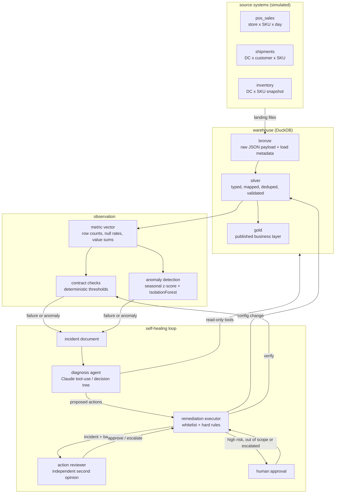
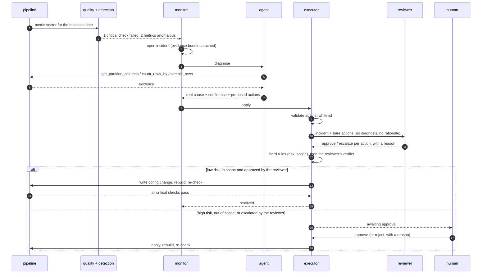

# Sentinel

**A data platform that notices when its own data is wrong, works out why, and fixes it.**

Sentinel runs a small consumer-goods warehouse - point-of-sale, shipments,
inventory - through a bronze/silver/gold pipeline. Every run is measured. When a
partition breaks a contract or drifts away from its own history, an incident is
opened, an agent investigates it with read-only tools, and a whitelisted
remediation is applied and then verified.

It runs end to end on a laptop with no cloud account, no credentials and no API
key:

```bash
pip install -e .
sentinel demo --rules-only
```

---

## The 90-second version

The demo builds six weeks of clean history, then injects one realistic failure per
day and lets the platform deal with it:

```
2025-02-18  Load job retried after a timeout and delivered the file twice.
  * INC-5b2cda2ad2 shipments critical -> resolved
      shipments: 1 quality check(s) failed (unique_natural_key)
      diagnosis duplicate_batch (confidence 90%, rules, 0 tool call(s), 0 ms)
      shipments contains duplicate natural keys (duplicate rate 0.333333).
      OK [0] enable_dedupe - deduplication on the natural key enabled for shipments
      OK [1] rerun_pipeline - pipeline rerun scheduled for 2025-02-18

2025-02-19  Retailer switched from reporting eaches to cases.
  * INC-2e4adda286 pos_sales warning -> awaiting_approval
      pos_sales: pos_sales.measure_sum__units_sold: observed 30,240.00
                 vs expected 2,620.50 (+1054.0%, robust z=99.0)
      diagnosis unit_of_measure (confidence 70%, rules, 0 tool call(s), 0 ms)
      pos_sales.units_sold is 11.53x its usual level on an unchanged row count,
      consistent with a change of reporting unit.
      OK [0] hold_downstream - gold publication held for 2025-02-19
      ?  [1] apply_unit_correction - risk=high requires human approval
      OK [2] open_upstream_ticket - ticket TICKET-2403c03c raised

      approval required for apply_unit_correction - approving as 'demo-operator'
  * INC-2e4adda286 pos_sales warning -> resolved
      OK [1] apply_unit_correction - correction CORR-2205e11b:
             pos_sales.units_sold multiplied by 0.086758 for 2025-02-19
```

Note what the detector did on the second day: row count was normal, so no contract
was broken. It was the *per-row value* that moved, by a suspiciously constant
factor - which is what a unit change looks like and what a demand spike does not.

Seven faults, seven correct root causes, and one clean control day at the end that
only stays clean because a fix from an earlier day is still holding.

| Business date | What went wrong upstream | Caught by | Diagnosis | Outcome |
|---|---|---|---|---|
| day 1 | Extract truncated - two thirds of stores missing | anomaly detector | `volume_drop` | held + ticket |
| day 2 | Load job fired twice | `unique_natural_key` | `duplicate_batch` | **resolved** |
| day 3 | Retailer switched eaches to cases | anomaly detector | `unit_of_measure` | **resolved** after approval |
| day 4 | Upstream join lost a lookup | `not_null_on_hand_cases` | `null_spike` | quarantined + ticket |
| day 5 | SFTP drop never landed | `partition_present` | `late_arrival` | held + ticket |
| day 6 | New SKUs activated before master sync | `referential_integrity_sku` | `referential_break` | quarantined + ticket |
| day 7 | Source renamed a column | `schema_complete` | `schema_drift` | **resolved** |
| day 8 | *(nothing - the rename persists)* | - | - | clean run |

Note which failures the *checks* caught and which they did not. Rules catch the
failures somebody already enumerated; the volume drop and the unit change break no
rule at all, and only show up against the metric's own history.

---

## Why it is built this way

Most data quality tooling stops at detection: a test fails, a dashboard turns red,
a human reads a Slack message at 08:30 and starts an investigation from scratch.
The expensive part is not noticing - it is the twenty minutes of "which column,
which day, what changed, what do we do about it" that follows.

Sentinel automates that middle part, and stops where automation should stop:

- **Detection is two layers, not one.** Deterministic contracts for known failure
  modes, an unsupervised detector for everything else.
- **Diagnosis is evidence-driven.** The agent gets tools, not a summary. It can
  list the columns actually present in an extract, compare group counts against
  yesterday, and read the rows that failed validation.
- **Remediation is bounded.** The agent proposes action names from a registry;
  an executor validates them, refuses anything else, and blocks high-risk actions
  until a human approves. See [ADR 4](docs/adr/0004-remediation-whitelist.md).
- **Nobody marks their own homework.** A second agent reviews every proposed
  action without seeing the first one's reasoning. Only what it approves runs
  unattended; whatever it doubts goes to a human, and so does anything high-risk,
  whatever it thinks. See [ADR 6](docs/adr/0006-independent-action-review.md).
- **Nothing is closed until it is verified.** The executor re-runs the pipeline,
  re-checks the contracts and re-scores the metrics against their baseline.
  `resolved` means the checks pass and the values look normal again. `remediated`
  means the damage was contained but the feed is still broken - a distinction
  worth keeping.

---

## Architecture



The remediation arrow lands on *configuration*, not on data. Actions write a
column mapping, a flag, a quarantine marker, a hold or a ticket; silver is a full
rebuild from bronze, so applying a fix means rebuilding, and undoing one means
deleting a row and rebuilding again.

### One incident, end to end



---

## Quickstart

```bash
python -m venv .venv && . .venv/bin/activate    # Windows: .venv\Scripts\activate
pip install -e ".[dev]"
sentinel demo --rules-only
```

That takes under three minutes - fifty pipeline runs over ~33k source rows - and
needs nothing else. Then:

```bash
sentinel serve            # incident console on http://127.0.0.1:8000
sentinel incidents        # the same thing in the terminal
sentinel show INC-xxxx    # one incident, with the agent's reasoning and timeline
sentinel eval --rules-only  # score the diagnosis engine against the golden set
sentinel eval-review --rules-only  # check that no harmful action gets past the gate
```

### The console

`sentinel serve` is a single page with three views:

- **Incidents** - counters and the incident list, each with its priority, reach
  and estimated loss.
- **One incident** - the diagnosis with its reasoning, the blast radius with the
  loss estimate and how it was built, failed checks and anomaly
  signals, a chart of the metric against its own history (the value as detected
  and after remediation), every action with a *What changes?* preview, and the
  timeline. For `apply_unit_correction` the preview gives the corrected total
  against a normal day and checks the factor store by store against the week
  before. A correction derived from the day's total always makes the total look
  right, so only the per-store check catches a unit change that hit some stores
  and not others.
- **Evals** - the last `sentinel eval` result per scenario and engine, side by
  side, with each day's verdict (right fix, incomplete, harmful).

### Running it with the LLM agent

```bash
export ANTHROPIC_API_KEY=sk-ant-...
sentinel demo             # same scenario, diagnosed by Claude
sentinel eval             # same scoring, so the two engines are comparable
```

With no key, `sentinel demo` uses the deterministic engine automatically and says
so. Nothing in the repository requires an API key - including the whole test
suite, which stubs the client rather than calling it.

### With Docker

```bash
docker compose run --rm seed     # build the warehouse and self-heal the scenario
docker compose up sentinel       # console on http://localhost:8000
```

---

## The agent

The interesting design constraint is that an LLM's output ends up changing
production data. The split that makes that safe:

**Reading** is what the tools do. All six are read-only:

| Tool | Answers |
|---|---|
| `get_metric_history` | how has this metric behaved for the last N days? |
| `get_partition_columns` | which columns are actually in the extract, versus what we expect? |
| `sample_rows` | what do the raw rows look like - or the ones that failed validation? |
| `count_rows_by` | is the shortfall spread evenly, or did specific stores go silent? |
| `get_failed_checks` | which contracts failed, with observed and threshold values? |
| `find_similar_incidents` | has this happened before, and how did it end? |

**Writing** is not something the agent can do at all. It ends its turn by calling
`submit_diagnosis` with a root cause, a confidence, its reasoning and a list of
proposed action *names and arguments*. The executor takes it from there:

```
proposal ──▶ in the whitelist? ──no──▶ recorded as failed, nothing runs
                 │yes
                 ▼
           arguments valid? ──no──▶ recorded as failed, nothing runs
                 │yes
                 ▼
           reviewer gives its verdict (recorded either way)
                 │
                 ▼
           hard rule tripped? ──yes──▶ awaiting human approval
           (risk = high, or another       (the reviewer's opinion is shown
            dataset or date)               to the human, and decides nothing)
                 │no
                 ▼
           reviewer approved? ──no──▶ awaiting human approval
                 │yes                    (also: no verdict, error, doubt)
                 ▼
           execute ──▶ rebuild ──▶ re-check ──▶ resolved / remediated
```

The eight permitted actions, with their risk levels, are in
[`remediation/actions.py`](src/sentinel/remediation/actions.py) - and the same
registry is rendered into the system prompt, so what the model is offered and what
the executor permits cannot drift apart.

Everything the agent reads from the warehouse is treated as untrusted input; the
prompt says so explicitly, and the architecture means a row value that reads like
an instruction still cannot cause a write.

### The reviewer

An agent that proposes an action and then decides it is safe to run has checked
nothing. So the proposal goes to a second agent first, and that one is kept
independent by what it is *not* given:

- **It sees** the incident as the monitor recorded it - failed checks, anomaly
  signals, the metric vector - and each action's name and arguments. The Claude
  reviewer also gets the same six read-only tools, so it can go and look.
- **It does not see** the diagnosis, the reasoning, or the rationale attached to
  each action. Free-text arguments (a hold's `reason`, a ticket's `summary` and
  `body`) are stripped as well: they are the one place the first agent could argue
  its case to the second.

It answers `approve` or `escalate` per action, with a reason. What that verdict
can do is deliberately lopsided:

| | Reviewer approves | Reviewer escalates, errors or says nothing |
|---|---|---|
| low / medium risk, in scope | runs | **human** |
| high risk (`apply_unit_correction`) | **human** - verdict shown as advice | **human** |
| another dataset or business date than the incident's | **human** | **human** |
| `manual` mode | **human** | **human** |

The rows that say *human* regardless are the hard rules. They live in
[`remediation/policy.py`](src/sentinel/remediation/policy.py) as plain comparisons,
are evaluated in the executor, and no verdict can lift them. A reviewer can
therefore only ever *narrow* what runs unattended: before it existed, every
low-risk proposal ran.

Failure is closed. An API error, a refusal, an exhausted tool budget, an action
missing from the answer, an exception in the reviewer - each one leaves the
action waiting for a human. This is the opposite of the diagnosis engine, which
falls back to rules when Claude is unavailable: a platform should keep
diagnosing, but no verdict is not an approval.

Like diagnosis, review has two implementations behind one protocol. The rule
reviewer ([`review/rules.py`](src/sentinel/review/rules.py)) approves an action
only when the monitor's own observations show the problem it fixes - dedupe when
the uniqueness check failed, a column mapping when the canonical column is gone
and the proposed source column really is new in the extract - and escalates
everything it has no rule for. It runs offline, in CI and without a key.

Every verdict is written to the incident: on the action (`review`, `hard_rules`)
and on the timeline as `action.reviewed`, next to the reason an action is waiting.

```bash
sentinel eval-review --rules-only    # or without the flag, to score the Claude reviewer
```

`eval-review` injects a fault, opens the incident, and puts hand-written proposals
in front of the gate - sound ones, and ones that would damage the day: quarantining
a whole partition to cure duplicates, mapping a measure onto an unrelated column,
a unit correction with the factor inverted, an action on yesterday's healthy
partition. Nothing is executed; it records what *would* have run. It exits
non-zero if a single harmful proposal is cleared, and CI runs it as a gate.

| Reviewer | Harmful approved | Wrongly approved | Sound actions pre-approved |
|---|---|---|---|
| rules | **0 / 9** | 0 / 15 | 9 / 9 |

Set `SENTINEL_REVIEWER__PROVIDER=off` to get the previous behaviour, where the
risk level alone decides.

### Learning from incident history

Every incident the loop closes is a labelled example: the signals that opened it,
the diagnosis, each action and what became of it. `find_similar_incidents` hands
the agent the closest ones before it diagnoses a new incident:

```json
{
  "compared_on": ["anomaly:measure_avg:increase", "anomaly:measure_sum:increase"],
  "precedents": [{
    "incident_id": "INC-4f1c9a02d7", "dataset": "pos_sales", "similarity": 1.0,
    "outcome": "a human rejected a proposed action - read the reason before repeating it",
    "diagnosis": {"root_cause": "unit_of_measure", "summary": "..."},
    "actions": [{"name": "apply_unit_correction", "status": "rejected",
                 "result": "only the northern stores changed unit", "decided_by": "dana"}],
    "verification": null
  }]
}
```

Three decisions shape it ([ADR 5](docs/adr/0005-precedents-not-embeddings.md)):

- **Similarity is set overlap, not an embedding.** An incident's signature is the
  checks that failed and the metrics that moved, with direction. Two incidents are
  alike when those sets overlap, and each match says which signals it shares.
- **Only incidents with an outcome count.** Resolved, contained, dismissed, or with
  an action a human rejected. An incident still open is an opinion nobody tested.
  Lookup also never sees the incident's own future, so a replayed eval stays honest.
- **A precedent is a lead, not evidence.** The same signals can have another cause,
  and past diagnoses came from an engine that can be wrong. The prompt tells the
  agent to confirm a precedent against today's data, and not to re-propose an action
  a human rejected unless today's evidence answers the reason they gave.

The rule engine does not use history. It stays the deterministic baseline.

### Blast radius and estimated loss

Every incident is assessed when it opens, before anyone diagnoses it: which
reports, dashboards, models and decisions take data from the affected dataset,
and roughly what is at stake in money.

```
* INC-0ecd139f50 pos_sales critical -> remediated
    impact P1 | 7 downstream consumer(s) (3 decisions, 1 dashboard, 2 reports, 1 model)
           | estimated loss ~$20,360 (range $10,180-$30,540)
```

Both come from one YAML file ([`impact.yml`](src/sentinel/impact/impact.yml),
replaced with `SENTINEL_IMPACT__CONFIG_PATH`):

```yaml
assets:
  demand_forecast:
    kind: model
    depends_on: [silver_pos_sales]
  replenishment_orders:
    kind: decision
    name: Automatic replenishment orders
    owner: Supply planning
    criticality: critical
    depends_on: [demand_forecast, silver_inventory, silver_shipments]
cost_model:
  exposure_hours: 8
  cost_per_hour_by_kind: {report: 40, dashboard: 80, decision: 300}
  cost_per_consumer: 50
  cost_per_record: {default: 0.01, pos_sales: 0.02}
```

- **Lineage is declared and followed transitively.** A broken sales file reaches
  the replenishment decision through the forecast, three hops away. Each consumer
  is listed with the path that connects it to the dataset.
- **The money figure is an estimate and says so.** It is the sum of three terms -
  per consumer-hour, per consumer, per record - using the rates in the file. The
  incident keeps the arithmetic and the assumptions beside the total, and reports
  a range. It ranks incidents against each other; it is not a measured loss.
- **The agent and the reviewer see it as context for urgency, not as evidence.**
  The prompt tells the agent to contain first when decisions are downstream, and
  that high stakes raise the bar for changing data. The hard rules never read it.

`sentinel show <incident>` prints the full report, the console shows it on the
incident page, and `sentinel impact [dataset]` lists what is downstream of a
dataset without an incident. `sentinel impact --check` validates the file.
See [ADR 7](docs/adr/0007-declared-lineage-and-estimated-loss.md).

### Evals

`sentinel eval` replays the scenario and scores the engine against the injected
fault - detection rate (including false positives on the clean day), root-cause
accuracy, and whether the actions a competent on-call engineer would take were
proposed. Both engines run through the same harness, which makes "is the LLM
earning its latency here?" a measurable question.

```
detection 100% | root cause 100% | actions 100% | 160.7s total     # engine: rules
```

On this scenario the decision tree scores 100%, because every fault is one
somebody already enumerated. That is the honest baseline, and it is why the rule
engine is the CI gate (`sentinel eval --rules-only --min-accuracy 1.0`) rather
than a placeholder.

#### The hard scenario

`sentinel eval --scenario hard` replays what the standard scenario cannot measure:

| Day | What went wrong upstream | What a good engine does |
|---|---|---|
| 1 | File delivered twice *and* in cases instead of eaches | dedupe **and** correct the unit |
| 2 | Extract truncated *and* new SKUs ahead of the master | quarantine **and** hold the date |
| 3 | Only some stores switched to cases (off-catalogue) | hold and ticket; **no** blanket unit correction |
| 4 | Returns netted into sales as negatives (off-catalogue) | call it unknown, hold and ticket |
| 5 | *(nothing)* | stay quiet |

Two extra numbers matter here. *Causes found* is the share of injected causes the
engine named, since a diagnosis can now carry `contributing_causes` next to its
root cause. *Harmful* is the share of days where it proposed an action that would
make things worse, such as rescaling a whole partition when only a third of it
changed unit.

#### The recurring scenario

`sentinel eval --scenario recurring` makes faults come back, which is the only way
to see what an engine does with its own history:

| Day | What went wrong upstream | Why it is there |
|---|---|---|
| 1 | Returns netted into sales as negatives | creates a precedent |
| 2 | Only some stores switched to cases | creates a precedent, contained with hold and ticket |
| 3 | Shipments extract truncated | creates a precedent |
| 4 | *(nothing)* | control |
| 5 | Returns netted again | **repeat**: day 1 is on record |
| 6 | *Every* store switched to cases | **lookalike**: same signals as day 2, but this one is fixable |
| 7 | Shipments truncated again | **repeat**: day 3 is on record |
| 8 | *(nothing)* | control |

Day 6 is the one that matters. An engine that copies the precedent holds and
tickets a partition it could have corrected; only today's rows tell the two apart.
The report adds *history consulted*: the share of diagnoses that called
`find_similar_incidents`.

Rule baseline: detection 100%, root cause 100%, right actions 50%, harmful 17%,
history consulted 0%. The Claude engine has not been measured on this scenario yet.

#### Rules against Claude

| | rules | Claude (mean of 5 runs) |
|---|---|---|
| detection | 100% | 100% (every run) |
| root cause | 100% | 100% (every run) |
| causes found | 75% | **100%** (every run) |
| right actions | 0% | **95%** (75%-100%) |
| harmful | 25% | **0%** (every run) |
| wall time per run | ~20 s | ~160 s |

*Claude: `sentinel eval --scenario hard --repeat 5`, default model and effort,
November 2026. Rules: deterministic, so one run is every run.*

The decision tree names a plausible headline every day and still gets every day
wrong. It stops at the first matching rule, so it fixes half of each compound
fault, and it proposes a full-partition unit correction for a change that only hit
some stores. That correction would have put every store outside its normal range.

In all five runs the Claude engine named both causes on both compound days,
refused the blanket correction on the partial unit change (holding the date and
raising a ticket instead), and called the netted returns `unknown` rather than
forcing them into a category. The only variation was day 1, the duplicated file
that was also in cases. In four runs out of five it proposed both dedupe and the
unit correction. In the fifth it found both causes but held the date and asked
upstream instead of correcting, a cautious call the scenario scores as incomplete.

This is still five hand-written days, so it shows where the decision tree breaks
and that an LLM closes the gap consistently, not how it would fare on a real
estate. To reproduce:

```bash
sentinel eval --scenario hard --repeat 5
```

This replays the scenario five times from a fresh warehouse and reports the mean
and the min-max range of each metric, plus, per day, in how many runs the engine
got it right. The console's Evals view shows the same. Budget about five times the
single-run time and tokens.

The scenario also caught a verification gap. On day 1, deduplicating made every
contract pass, so the incident used to close as `resolved` while units were still
twelve times too high. Verification now also re-runs the anomaly detector on the
value metrics, and that day correctly ends as `remediated`.

---

## What is in here

```
src/sentinel/
  generator/     synthetic CPG source systems + the fault catalogue
  elt/           warehouse, medallion pipeline, operational config the agent may change
  quality/       metric collection, declarative checks, Pydantic row contracts
  detection/     seasonal robust z-score + IsolationForest over pipeline metrics
  agent/         investigation tools, prompts, the Claude engine, the rule engine
  remediation/   the action whitelist, the hard rules and the executor that enforces them
  review/        the independent action reviewer: Claude and rule implementations
  incidents/     the incident document, its store, and precedent lookup
  impact/        declared lineage, blast radius and the loss estimate
  evals/         scoring harnesses for the diagnosis engines and the action gate
  api/           FastAPI service + a dependency-free console
  monitor.py     the loop that ties observation to healing
  scenario.py    the demo timeline, shared by the demo, the evals and the tests
infra/terraform/ Azure Container Apps deployment
docs/adr/        why the seven load-bearing decisions were made
```

### Design decisions

- [ADR 1 - DuckDB as the warehouse](docs/adr/0001-duckdb-as-the-warehouse.md)
- [ADR 2 - Incidents as documents](docs/adr/0002-incidents-as-documents.md)
- [ADR 3 - Two diagnosis engines, one interface](docs/adr/0003-two-diagnosis-engines.md)
- [ADR 4 - Remediation as a whitelist with a risk gate](docs/adr/0004-remediation-whitelist.md)
- [ADR 5 - Precedents by signal overlap, not embeddings](docs/adr/0005-precedents-not-embeddings.md)
- [ADR 6 - An independent reviewer that can only narrow autonomy](docs/adr/0006-independent-action-review.md)
- [ADR 7 - Declared lineage and a loss estimate that says it is one](docs/adr/0007-declared-lineage-and-estimated-loss.md)

---

## Development

```bash
make check      # ruff + mypy + pytest, the same three things CI runs
make test       # pytest with coverage
make demo       # the full scenario
```

132 tests, about four minutes, entirely offline. They exercise the real warehouse
rather than mocks, so a broken SQL string fails a test; the Claude engine is
tested against a stubbed client, including its failure and fallback paths.

CI runs lint and strict `mypy`, the suite on Python 3.11 and 3.12, an end-to-end
acceptance job that replays the incident scenario and fails the build if the
platform stops identifying every injected fault, and a container build.

---

## Deployment

`docker compose` is the local path. [`infra/terraform`](infra/terraform) is the
same thing on Azure: Container Apps for the console, a scheduled Container Apps
Job for the nightly pipeline, an Azure Files share that both mount for the
warehouse file, ADLS Gen2 for the layers, Key Vault for the secrets, and a managed
identity so the application carries no connection string.

### Who may approve

Approving or rejecting an action changes production data, so the console has to
know who is asking. Set `SENTINEL_APPROVER_TOKENS` to `name:token` pairs and every
write needs `Authorization: Bearer <token>`; the approver recorded on the incident
is the name that token belongs to, never a name the client sent. With no tokens
configured, writes are accepted only from the loopback interface, so
`sentinel serve` on a laptop needs no setup and a deployment that forgot to
configure tokens fails closed. Reads stay open either way.

```bash
export SENTINEL_APPROVER_TOKENS="alice:$(openssl rand -hex 24)"
curl -X POST -H "Authorization: Bearer <alice's token>" \
     http://localhost:8000/api/incidents/INC-xxxx/actions/1/approve
```

`remediation_mode` defaults to `manual` there. Autonomy is opt-in per environment:
nothing self-applies in a new deployment until someone has watched it propose the
right thing a few times.

---

## Limitations

Worth being explicit about, since the demo makes it all look tidy:

- **Scale.** DuckDB in one process. Silver rebuilds fully on every run, which is
  cheap at 100k rows and wrong at 100 million. Silver and gold would move to
  Databricks or Synapse; the operational tables would not.
- **Synthetic faults, small scenarios.** The hard scenario adds compound and
  off-catalogue faults, but it is five days long and hand-written. It shows
  where the decision tree breaks; it is not a benchmark.
- **The detector is unsupervised by necessity.** With no labelled incident history
  there is nothing to train on, so it is a robust z-score against a weekday
  baseline plus an IsolationForest. Once incidents accumulate, the labels the
  platform generates are exactly the training set a supervised model would need.
- **History can repeat a mistake.** A precedent carries the diagnosis an engine made
  at the time. Outcomes and human rejections are attached so a bad one is visible,
  and the prompt asks for confirmation on today's data, but nothing stops a wrong
  diagnosis that happened to end as `remediated` from being offered again.
- **The loss estimate is arithmetic on assumptions.** The rates and the exposure
  window in `impact.yml` are typed in, not measured, and the shipped ones are
  illustrative. Lineage is per dataset, not per column, and it describes what an
  incident puts at stake rather than what it cost after it was contained.
- **Freshness is not modelled.** The generator drops files immediately, so late
  arrival is modelled as absence rather than as lateness. A real deployment would
  measure the lag between the business date and the load.
- **The console is one HTML file with no build step.** It covers incidents, a
  metric chart, action previews and saved eval results. It has no user accounts
  beyond approver tokens and no live updates beyond a 15-second refresh.

---

## License

MIT. The brands, SKUs and customers in the generator are invented.
