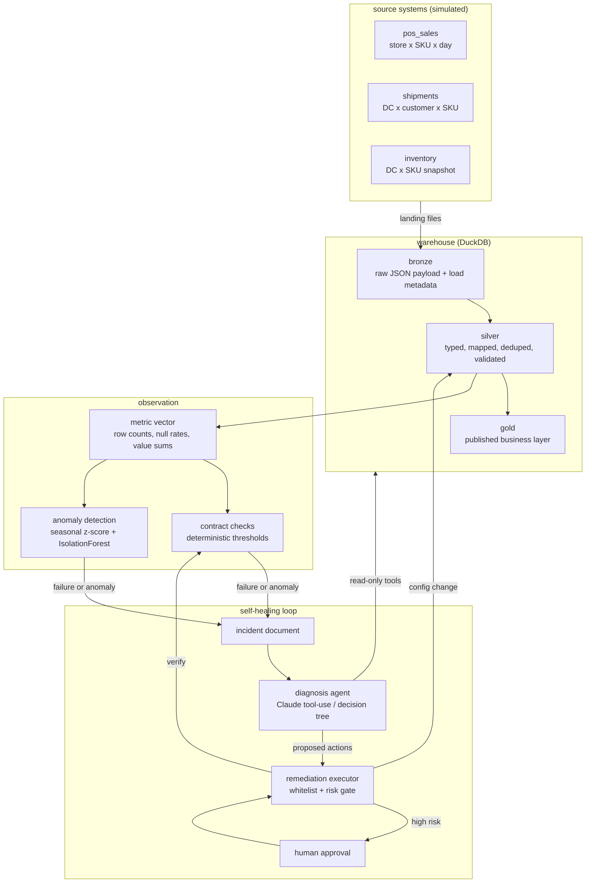
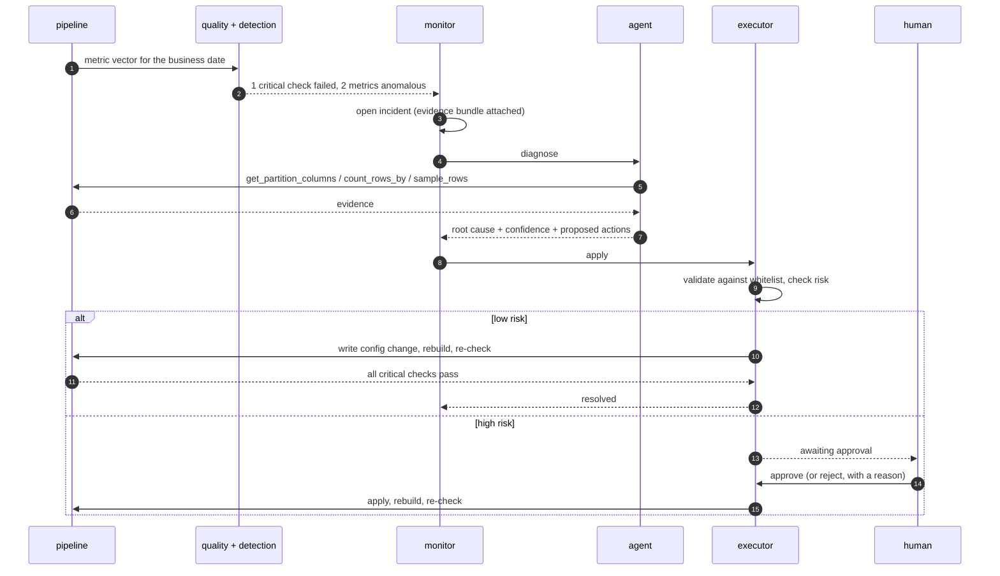

# Sentinel

**A data platform that notices when its own data is wrong, works out why, and fixes it.**

Sentinel runs a small consumer-goods warehouse - point-of-sale, shipments,
inventory - through a bronze/silver/gold pipeline. Every run is measured. When a
partition breaks a contract or drifts away from its own history, an incident is
opened, an agent investigates it with read-only tools, and a whitelisted
remediation is applied and then verified.

It runs end to end on a laptop with no cloud account, no credentials and no API
key:

```bash
pip install -e .
sentinel demo --rules-only
```

---

## The 90-second version

The demo builds six weeks of clean history, then injects one realistic failure per
day and lets the platform deal with it:

```
2025-02-18  Load job retried after a timeout and delivered the file twice.
  * INC-5b2cda2ad2 shipments critical -> resolved
      shipments: 1 quality check(s) failed (unique_natural_key)
      diagnosis duplicate_batch (confidence 90%, rules, 0 tool call(s), 0 ms)
      shipments contains duplicate natural keys (duplicate rate 0.333333).
      OK [0] enable_dedupe - deduplication on the natural key enabled for shipments
      OK [1] rerun_pipeline - pipeline rerun scheduled for 2025-02-18

2025-02-19  Retailer switched from reporting eaches to cases.
  * INC-2e4adda286 pos_sales warning -> awaiting_approval
      pos_sales: pos_sales.measure_sum__units_sold: observed 30,240.00
                 vs expected 2,620.50 (+1054.0%, robust z=99.0)
      diagnosis unit_of_measure (confidence 70%, rules, 0 tool call(s), 0 ms)
      pos_sales.units_sold is 11.53x its usual level on an unchanged row count,
      consistent with a change of reporting unit.
      OK [0] hold_downstream - gold publication held for 2025-02-19
      ?  [1] apply_unit_correction - risk=high requires human approval
      OK [2] open_upstream_ticket - ticket TICKET-2403c03c raised

      approval required for apply_unit_correction - approving as 'demo-operator'
  * INC-2e4adda286 pos_sales warning -> resolved
      OK [1] apply_unit_correction - correction CORR-2205e11b:
             pos_sales.units_sold multiplied by 0.086758 for 2025-02-19
```

Note what the detector did on the second day: row count was normal, so no contract
was broken. It was the *per-row value* that moved, by a suspiciously constant
factor - which is what a unit change looks like and what a demand spike does not.

Seven faults, seven correct root causes, and one clean control day at the end that
only stays clean because a fix from an earlier day is still holding.

| Business date | What went wrong upstream | Caught by | Diagnosis | Outcome |
|---|---|---|---|---|
| day 1 | Extract truncated - two thirds of stores missing | anomaly detector | `volume_drop` | held + ticket |
| day 2 | Load job fired twice | `unique_natural_key` | `duplicate_batch` | **resolved** |
| day 3 | Retailer switched eaches to cases | anomaly detector | `unit_of_measure` | **resolved** after approval |
| day 4 | Upstream join lost a lookup | `not_null_on_hand_cases` | `null_spike` | quarantined + ticket |
| day 5 | SFTP drop never landed | `partition_present` | `late_arrival` | held + ticket |
| day 6 | New SKUs activated before master sync | `referential_integrity_sku` | `referential_break` | quarantined + ticket |
| day 7 | Source renamed a column | `schema_complete` | `schema_drift` | **resolved** |
| day 8 | *(nothing - the rename persists)* | - | - | clean run |

Note which failures the *checks* caught and which they did not. Rules catch the
failures somebody already enumerated; the volume drop and the unit change break no
rule at all, and only show up against the metric's own history.

---

## Why it is built this way

Most data quality tooling stops at detection: a test fails, a dashboard turns red,
a human reads a Slack message at 08:30 and starts an investigation from scratch.
The expensive part is not noticing - it is the twenty minutes of "which column,
which day, what changed, what do we do about it" that follows.

Sentinel automates that middle part, and stops where automation should stop:

- **Detection is two layers, not one.** Deterministic contracts for known failure
  modes, an unsupervised detector for everything else.
- **Diagnosis is evidence-driven.** The agent gets tools, not a summary. It can
  list the columns actually present in an extract, compare group counts against
  yesterday, and read the rows that failed validation.
- **Remediation is bounded.** The agent proposes action names from a registry;
  an executor validates them, refuses anything else, and blocks high-risk actions
  until a human approves. See [ADR 4](docs/adr/0004-remediation-whitelist.md).
- **Nothing is closed until it is verified.** The executor re-runs the pipeline and
  re-checks the data. `resolved` means the checks pass. `remediated` means the
  damage was contained but the feed is still broken - a distinction worth keeping.

---

## Architecture



The remediation arrow lands on *configuration*, not on data. Actions write a
column mapping, a flag, a quarantine marker, a hold or a ticket; silver is a full
rebuild from bronze, so applying a fix means rebuilding, and undoing one means
deleting a row and rebuilding again.

### One incident, end to end



---

## Quickstart

```bash
python -m venv .venv && . .venv/bin/activate    # Windows: .venv\Scripts\activate
pip install -e ".[dev]"
sentinel demo --rules-only
```

That takes under three minutes - fifty pipeline runs over ~33k source rows - and
needs nothing else. Then:

```bash
sentinel serve            # incident console on http://127.0.0.1:8000
sentinel incidents        # the same thing in the terminal
sentinel show INC-xxxx    # one incident, with the agent's reasoning and timeline
sentinel eval --rules-only  # score the diagnosis engine against the golden set
```

### Running it with the LLM agent

```bash
export ANTHROPIC_API_KEY=sk-ant-...
sentinel demo             # same scenario, diagnosed by Claude
sentinel eval             # same scoring, so the two engines are comparable
```

With no key, `sentinel demo` uses the deterministic engine automatically and says
so. Nothing in the repository requires an API key - including the whole test
suite, which stubs the client rather than calling it.

### With Docker

```bash
docker compose run --rm seed     # build the warehouse and self-heal the scenario
docker compose up sentinel       # console on http://localhost:8000
```

---

## The agent

The interesting design constraint is that an LLM's output ends up changing
production data. The split that makes that safe:

**Reading** is what the tools do. All five are read-only:

| Tool | Answers |
|---|---|
| `get_metric_history` | how has this metric behaved for the last N days? |
| `get_partition_columns` | which columns are actually in the extract, versus what we expect? |
| `sample_rows` | what do the raw rows look like - or the ones that failed validation? |
| `count_rows_by` | is the shortfall spread evenly, or did specific stores go silent? |
| `get_failed_checks` | which contracts failed, with observed and threshold values? |

**Writing** is not something the agent can do at all. It ends its turn by calling
`submit_diagnosis` with a root cause, a confidence, its reasoning and a list of
proposed action *names and arguments*. The executor takes it from there:

```
proposal ──▶ in the whitelist? ──no──▶ recorded as failed, nothing runs
                 │yes
                 ▼
           arguments valid? ──no──▶ recorded as failed, nothing runs
                 │yes
                 ▼
           risk = high? ──yes──▶ awaiting human approval
                 │no
                 ▼
           execute ──▶ rebuild ──▶ re-check ──▶ resolved / remediated
```

The eight permitted actions, with their risk levels, are in
[`remediation/actions.py`](src/sentinel/remediation/actions.py) - and the same
registry is rendered into the system prompt, so what the model is offered and what
the executor permits cannot drift apart.

Everything the agent reads from the warehouse is treated as untrusted input; the
prompt says so explicitly, and the architecture means a row value that reads like
an instruction still cannot cause a write.

### Evals

`sentinel eval` replays the scenario and scores the engine against the injected
fault - detection rate (including false positives on the clean day), root-cause
accuracy, and whether the actions a competent on-call engineer would take were
proposed. Both engines run through the same harness, which makes "is the LLM
earning its latency here?" a measurable question.

```
detection 100% | root cause 100% | actions 100% | 160.7s total     # engine: rules
```

On this scenario the decision tree scores 100%, because every fault is one
somebody already enumerated. That is the honest baseline, and it is why the rule
engine is the CI gate (`sentinel eval --rules-only --min-accuracy 1.0`) rather
than a placeholder. The LLM's advantage is the eighth failure mode - the one
nobody wrote a rule for - which is exactly the case a fixed scenario cannot
measure.

---

## What is in here

```
src/sentinel/
  generator/     synthetic CPG source systems + the fault catalogue
  elt/           warehouse, medallion pipeline, operational config the agent may change
  quality/       metric collection, declarative checks, Pydantic row contracts
  detection/     seasonal robust z-score + IsolationForest over pipeline metrics
  agent/         investigation tools, prompts, the Claude engine, the rule engine
  remediation/   the action whitelist and the executor that enforces it
  incidents/     the incident document and its store
  evals/         scoring harness for the diagnosis engines
  api/           FastAPI service + a dependency-free console
  monitor.py     the loop that ties observation to healing
  scenario.py    the demo timeline, shared by the demo, the evals and the tests
infra/terraform/ Azure Container Apps deployment
docs/adr/        why the four load-bearing decisions were made
```

### Design decisions

- [ADR 1 - DuckDB as the warehouse](docs/adr/0001-duckdb-as-the-warehouse.md)
- [ADR 2 - Incidents as documents](docs/adr/0002-incidents-as-documents.md)
- [ADR 3 - Two diagnosis engines, one interface](docs/adr/0003-two-diagnosis-engines.md)
- [ADR 4 - Remediation as a whitelist with a risk gate](docs/adr/0004-remediation-whitelist.md)

---

## Development

```bash
make check      # ruff + mypy + pytest, the same three things CI runs
make test       # pytest with coverage
make demo       # the full scenario
```

95 tests, about four minutes, entirely offline. They exercise the real warehouse
rather than mocks, so a broken SQL string fails a test; the Claude engine is
tested against a stubbed client, including its failure and fallback paths.

CI runs lint and strict `mypy`, the suite on Python 3.11 and 3.12, an end-to-end
acceptance job that replays the incident scenario and fails the build if the
platform stops identifying every injected fault, and a container build.

---

## Deployment

`docker compose` is the local path. [`infra/terraform`](infra/terraform) is the
same thing on Azure: Container Apps for the console, a scheduled Container Apps
Job for the nightly pipeline, ADLS Gen2 for the layers, Key Vault for the API key,
and a managed identity so nothing carries a connection string. Storage account
keys are disabled outright.

`remediation_mode` defaults to `manual` there. Autonomy is opt-in per environment:
nothing self-applies in a new deployment until someone has watched it propose the
right thing a few times.

---

## Limitations

Worth being explicit about, since the demo makes it all look tidy:

- **Scale.** DuckDB in one process. Silver rebuilds fully on every run, which is
  cheap at 100k rows and wrong at 100 million. Silver and gold would move to
  Databricks or Synapse; the operational tables would not.
- **One fault per day.** The scenario injects one failure at a time. Two
  interacting faults on the same partition would be a harder and more realistic
  test, and is the next thing I would add.
- **The detector is unsupervised by necessity.** With no labelled incident history
  there is nothing to train on, so it is a robust z-score against a weekday
  baseline plus an IsolationForest. Once incidents accumulate, the labels the
  platform generates are exactly the training set a supervised model would need.
- **Freshness is not modelled.** The generator drops files immediately, so late
  arrival is modelled as absence rather than as lateness. A real deployment would
  measure the lag between the business date and the load.
- **The console is deliberately minimal.** One HTML file, no build step. Enough to
  approve an action and read a diagnosis; not a product.

---

## License

MIT. The brands, SKUs and customers in the generator are invented.
